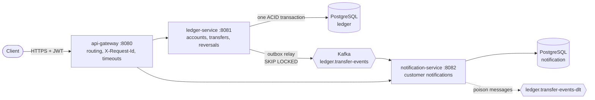

# Ledger Platform

An event-driven payments backend made of three Spring Boot services. Customers open wallets and move money through a single API gateway. Every transfer is a double-entry posting inside one database transaction, retries never charge twice, and payees are notified asynchronously through Kafka.

**Stack:** Java 21, Spring Boot 4.1, Spring Cloud Gateway (Server Web MVC), Spring Security (OAuth2 resource server, JWT), Spring Data JPA / Hibernate, Spring Kafka, PostgreSQL 18, Apache Kafka 4 (KRaft), Flyway, springdoc OpenAPI, JUnit 5, Embedded Kafka, Docker, Docker Compose, GitHub Actions.

## Architecture



| Service | Responsibility | Owns |
|---|---|---|
| `api-gateway` | Single entry point, path routing, request ID propagation, connect/read timeouts | nothing (stateless) |
| `ledger-service` | Token issuing, accounts, transfers, reversals, double-entry ledger, transactional outbox | `ledger` database |
| `notification-service` | Consumes transfer events, stores one notification per party, serves each user their own feed | `notification` database |

Each service owns its database; they share no tables. The only coupling is the event contract (`TransferEvent`) and the JWT signing key.

## API (through the gateway)

| Endpoint | Who | Purpose |
|---|---|---|
| `POST /api/v1/auth/token` | anyone (HTTP Basic) | Returns a signed HS256 JWT |
| `POST /api/v1/accounts` | customer | Open a wallet owned by the caller |
| `GET /api/v1/accounts`, `GET /api/v1/accounts/{id}` | owner or admin | Balance and status |
| `GET /api/v1/accounts/{id}/statement` | owner or admin | Paged ledger lines with running balance |
| `POST /api/v1/transfers` | owner of the source account | Move money; requires an `Idempotency-Key` header |
| `GET /api/v1/transfers/{id}` | either party or admin | Transfer lookup |
| `POST /api/v1/transfers/{id}/reversal` | admin | Compensating transfer; at most one per transfer |
| `POST /api/v1/accounts/{id}/freeze` | admin | Block an account |
| `GET /api/v1/notifications` | any user | The caller's own notifications |

Demo users: `asha / asha-pass`, `ravi / ravi-pass` (customers), `admin / admin-pass`. Swagger UI for the ledger: `http://localhost:8081/swagger-ui.html`.

## Design decisions

**Money movement stays in one service.** Debit, credit, both ledger legs and the outbox row commit in a single PostgreSQL transaction. Splitting accounts and transfers into separate services would turn every payment into a distributed saga for no benefit, so the service boundary is drawn around the consistency boundary.

**Deadlock-free locking.** Both account rows are locked with `SELECT ... FOR UPDATE` in a fixed UUID order, so A to B and B to A transfers running at the same moment cannot wait on each other. A test fires 200 concurrent transfers around a three-account ring on virtual threads against real PostgreSQL and checks that money is conserved and the ledger nets to zero.

**Idempotent writes.** The `Idempotency-Key` is stored with a SHA-256 hash of the request. A retry with the same body returns the original transfer, the same key with a different body returns `409`, and if two identical requests race, the unique index picks the winner and the loser replays its result.

**Authorization at the resource, not just the endpoint.** Customers can only read or debit accounts they own (checked inside the transaction, after the row is locked). Reversals and freezes need the `admin` scope.

**Transactional outbox, at-least-once delivery.** Events are written to `outbox_event` in the business transaction and relayed by a scheduler that claims rows with `FOR UPDATE SKIP LOCKED`, so several ledger instances can relay in parallel without double-claiming. The relay waits for the Kafka ack; a failed send leaves the row for the next poll.

**Idempotent, failure-tolerant consumer.** Because delivery is at-least-once, the notification service enforces `UNIQUE (event_id, recipient)`. Transient failures are retried 3 times; unreadable messages go straight to `ledger.transfer-events-dlt` so one poison message cannot block a partition.

**Security in depth.** The gateway routes but does not authenticate; every service validates the JWT itself, so traffic that bypasses the gateway is still protected.

## Verified failure scenarios

These were run against the real stack (PostgreSQL 18, Kafka 4.2) during development:

1. **Kafka outage.** With the broker stopped, `POST /transfers` still succeeded and the event stayed in the outbox (`published_at IS NULL`). After Kafka restarted, the relay published it and the payee's notification appeared about 8 seconds later. No event was lost.
2. **Startup race (bug found and fixed).** When the notification service started before the ledger, its subscription made the broker auto-create the topic with 1 partition; the ledger then grew it to 3 and the consumer did not see the new partitions for up to 5 minutes, so some notifications were late. Fix: both services declare the topic with 3 partitions, and consumers refresh metadata every 30 seconds.
3. **Duplicate and poison messages.** Covered by tests: duplicates create no extra rows, malformed JSON lands in the DLT and the next valid message is still processed.

## Run it

With Docker:

```bash
docker compose up -d --build --wait
./scripts/smoke-test.sh
```

Without Docker (PostgreSQL 18 and Kafka installed locally):

```bash
./mvnw -B package -DskipTests
java -jar notification-service/target/notification-service-1.0.0.jar &
java -jar ledger-service/target/ledger-service-1.0.0.jar &
java -jar api-gateway/target/api-gateway-1.0.0.jar &
./scripts/smoke-test.sh
```

The smoke test logs in, opens two accounts, transfers money, retries with the same key, tries to debit someone else's account, waits for the Kafka notification, reverses the transfer and checks the request ID header.

## Tests

```bash
./mvnw verify      # needs PostgreSQL on localhost:5432 with ledger_test and notification_test databases
```

19 tests: ledger API and security, idempotency, reversals, the 200-thread concurrency test and Kafka publishing (embedded broker) in `ledger-service`; idempotent consumption, per-user access and dead-lettering in `notification-service`; routing and request IDs in `api-gateway`. CI runs them against a PostgreSQL 18 service container, then boots the whole platform with Docker Compose and runs the smoke test.

## Not built yet

Outbox row cleanup, per-client rate limiting at the gateway, distributed tracing (OpenTelemetry), multi-currency transfers and an external identity provider instead of in-memory demo users.
